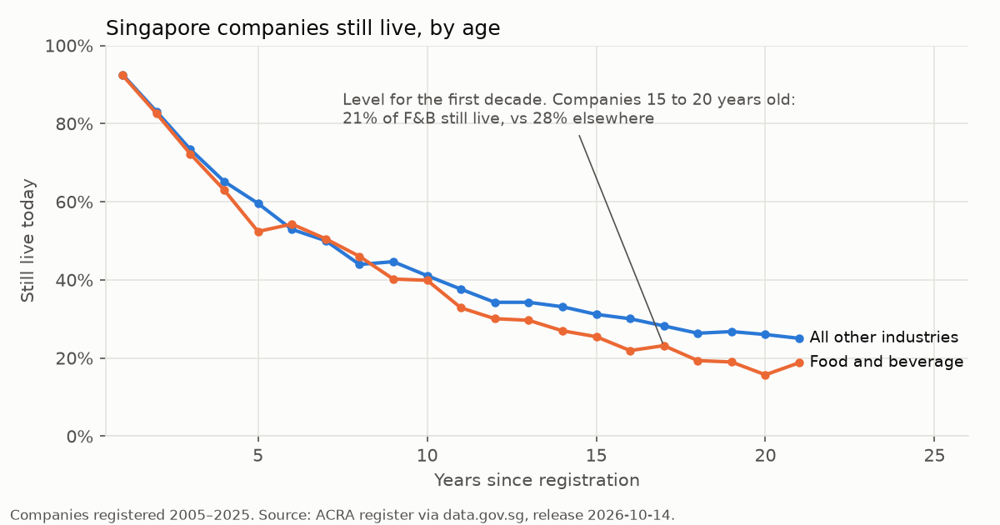
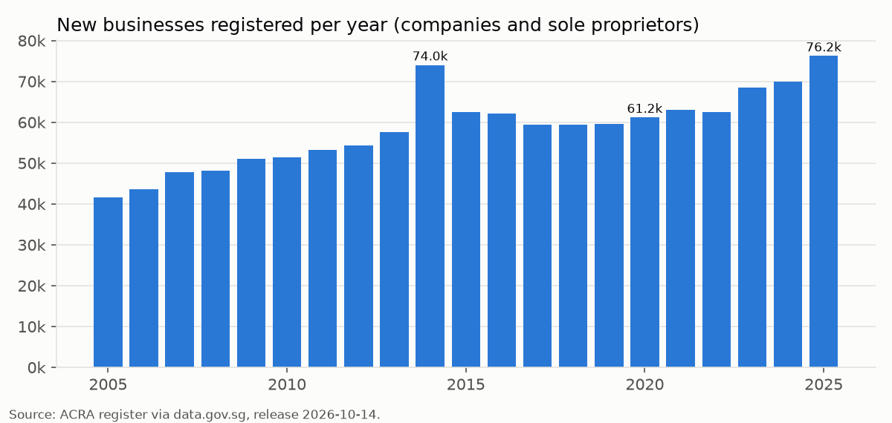

# sg-business-pulse

**A monthly data pipeline that tracks every business in Singapore: 2.1 million
companies and sole proprietors from the ACRA register, plus SingStat's retail and
F&B sales indices.** It downloads only what changed, checks each release before
using it, keeps a full history of every business's status, and publishes tables an
SME owner, lender or analyst can use directly.

Built with Python, DuckDB and Dagster. 40 tests. A GitHub Action refreshes the data
monthly.



## What it found (release of 14 Oct 2026)

- **624,271 businesses are live today**, out of 2,124,508 ever registered.
  27,376 of the live ones are food and beverage businesses.
- **F&B companies close at the same rate as other companies for about ten years,
  then fall behind.** Among companies 15 to 20 years old, 21% of F&B are still
  live, against 28% in other industries.
- **Sole proprietorships close much faster than companies.** Five years after
  registering, 59% of companies are still live, against 32% of sole proprietors
  (24% in F&B).
- **2025 was a record year for new businesses: 76,206 registrations.** The only
  earlier spike, in 2014, came from sole proprietors in wholesale and retail,
  which nearly doubled in one year (7,396 to 13,514).



"Live" means the registration is current. A dormant company is still live, and a
closure can be a planned retirement rather than a failure, so read these figures as
"still registered", not "still profitable".

## The problem it solves

ACRA publishes the register as **27 CSV files (660 MB)**, one per first letter of a
business's name. Each month the whole set is replaced, and **nothing says what
changed**. If you only keep the latest copy, you can never answer "when did this
company get struck off?" or "how many cafés closed last month?".

This pipeline keeps that history itself:

```
data.gov.sg (27 files) ─┐
                        ├─ extract ─ contracts ─ staging ─ entity_history ─ marts ─ results/*.csv
SingStat Table Builder ─┘   only what    stop on    clean    one row per     tables for
                            changed      bad data   types    change (SCD2)   SME questions
```

| Step | What it does | Why it matters |
|---|---|---|
| **Extract** (`pulse/extract.py`) | Checks each file's publish time and SHA-256 against a manifest; downloads only changed files; retries rate limits (data.gov.sg returns HTTP 429 under load) | A re-run lands nothing new, and an unchanged month costs 27 small API calls instead of 660 MB |
| **Contracts** (`pulse/contracts.py`) | Blocks the run if a column is missing, a UEN is duplicated or blank, dates don't parse, the row count jumps by more than a few percent, or ACRA is half-way through republishing | A truncated download or changed export stops the pipeline instead of corrupting the history |
| **Staging** (`pulse/sql/stg_entities.sql`) | Turns ACRA's `na` into nulls, types dates, validates postcodes and SSIC industry codes, and groups 37 status labels into live / closing / closed / converted | 2% of postcodes are the pre-1995 4-digit format and 0.35% of industry codes are a legacy 4-digit scheme. Both are flagged, not guessed |
| **History** (`pulse/history.py`) | Compares each release with the open version of every business. Records new, changed, removed and reappeared businesses as Type 2 versions with `valid_from` / `valid_to` | Answers "what did the register look like on any date" and "what changed this month" |
| **Marts** (`pulse/sql/marts.sql`) | Registrations per month by industry, survival by registration year, live businesses by postal sector, monthly status changes, sales indices with year-on-year change | The tables the findings above come from |

Dagster runs these steps as assets, with the contracts as **blocking asset
checks**: if a check fails, nothing downstream is rebuilt.

## Design decisions

- **A release is all 27 files or nothing.** If some files carry this month's
  publish date and others last month's, ACRA is still republishing. The
  `release_complete` contract blocks the run until the set is whole, so the
  register is never a mix of two months.
- **A file republished with identical bytes is not a new file.** It stays in last
  month's folder but counts as part of this month's release (tested in
  `test_unchanged_file_carries_forward_into_the_new_release`).
- **The history tracks ACRA's own fields only** (name, status, industry code,
  postcode). Derived fields such as the status group are worked out when a table is
  read. Changing a business rule later can then never show up as thousands of fake
  status changes.
- **Releases are applied in order, exactly once.** The same release twice is a
  no-op; an older release than the latest applied is refused; a failure partway
  through rolls back.
- **The warehouse file is disposable.** All state is `state/entity_history.parquet`
  plus the download manifest. Delete the DuckDB file and rerun; nothing is lost
  (tested end to end).
- **Monthly refresh on GitHub Actions** (`.github/workflows/refresh.yml`). The
  history is too big for git, so it is stored as assets on a GitHub release
  tagged `state`, restored at the start of each run and saved at the end. The
  refreshed `results/*.csv` and charts are committed back.

The status-change table (`mart_status_changes`) starts empty: change tracking began
with the 14 Oct 2026 release, and the first month-on-month changes arrive with the
November release. The tests show what it records using hand-written releases.

## Run it

```bash
pip install -r requirements.txt
python -m pulse run              # download (~660 MB first time), check, build: ~2 min
python -m pulse run --skip-extract   # rebuild from files already downloaded
python scripts/charts.py         # redraw docs/*.png
pytest                           # 40 tests, no network needed

dagster dev -m pulse.definitions # optional: the Dagster UI at http://localhost:3000
```

A run prints each contract:

```
[ok  ] release_complete: publish dates in release: 2026-10-14: 27 files
[ok  ] uen_unique_and_present: 0 blank UENs, 0 duplicated UENs
[ok  ] registration_dates_parse: 100.0000% of 2,124,508 rows have a valid registration date (need 99.9%)
...
```

## Tests

| File | Covers |
|---|---|
| `tests/test_history.py` | each kind of change, one open version per business, no overlapping versions, reappearance, idempotency, out-of-order refusal, rollback on failure, point-in-time lookup |
| `tests/test_contracts_and_staging.py` | every blocking contract, half-published and carried-forward releases, all 37 status labels mapped, postcode and SSIC cleaning |
| `tests/test_extract.py` | change detection against a fake data.gov.sg: skip unchanged, ignore identical republishes, retry 429s, restore missing files, page through SingStat |
| `tests/test_pipeline.py` | two monthly Dagster runs end to end; a broken release stops before the history is touched |

## Outputs (`results/`)

| File | One row per |
|---|---|
| `mart_formations_monthly.csv` | month × industry × legal form (registrations since 2000) |
| `mart_cohort_survival.csv` | registration year × industry × legal form (registered, still live, share) |
| `mart_live_by_sector.csv` | postal sector × industry (live businesses) |
| `mart_status_changes.csv` | release × change type × status group (from November 2026) |
| `mart_sales_indices.csv` | SingStat series × month (index value, year-on-year change) |

Data: [ACRA Information on Corporate Entities](https://data.gov.sg/collections/2/view)
and SingStat [Retail Sales Index](https://tablebuilder.singstat.gov.sg/table/TS/M602121)
/ [F&B Services Index](https://tablebuilder.singstat.gov.sg/table/TS/M602131), under
the Singapore Open Data Licence.
